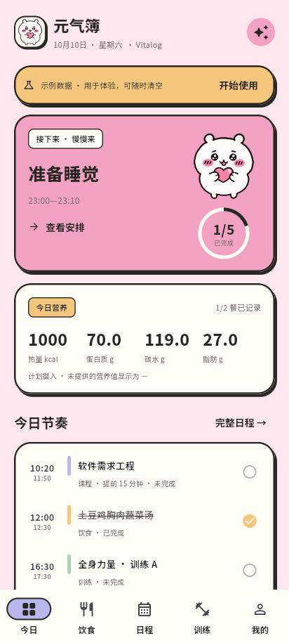
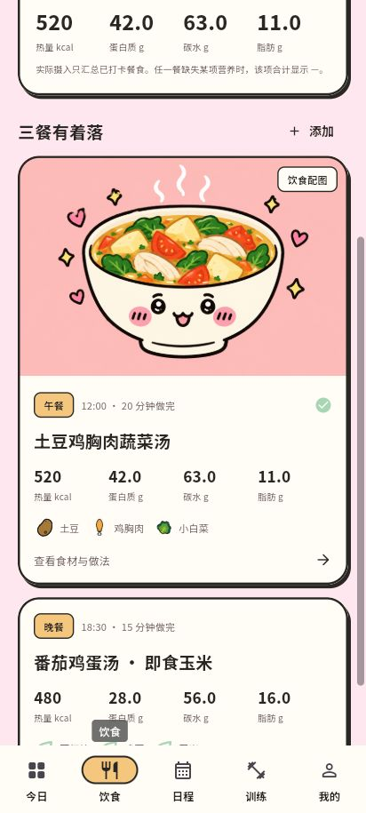

# 元气簿 Vitalog

安卓个人健康与生活计划应用。第一版目标是让饮食、训练、日历、习惯和身体记录形成完整闭环，所有数据保存在本机。

[](LICENSE)

 

## 使用

1. 建立身体档案，填写做饭条件、训练场地和目标。
2. 在「AI 计划」选择模块与周期，生成提示词。复制前可以查看、删改，也可以勾选最近一周记录。
3. 在你使用的外部 AI 中生成计划，将 JSON 粘贴回应用，或导入 `.json` / `.ics` 文件。
4. 预览、修改时间与提醒，检查冲突，再加入日历。
5. 用「按计划吃完」记录实际饮食并扣库存；训练可逐组记录与休息计时；作息用「准备睡觉」「已起床」记录，也能补填。
6. 在「我的 → 备份与恢复」导出完整 JSON 备份。

首次安装为空档案。可选择「体验示例」，示例是虚构的界面演示数据，不是实际健康记录或饮食建议。

## 已实现的功能

- 粉色与奶白卡通界面、粗黑描边与贴纸小伙伴，模块保留撞色；手机底栏、宽屏侧栏、浅色/深色/随系统主题。
- 菜谱、食材用量、制作步骤、每餐与每天计划/实际营养，未知数值保留为空。
- 食材库存，kg/斤/g 与 l/ml 换算；采购清单按未来 7 天未完成餐单减去库存。
- 打卡、改餐、撤销与库存一起保存；重复完成不会重复扣库存；库存不足可选择关闭本餐扣减。
- 日/周日程，手工重复安排，单次或后续修改；未完成事项保留。
- `.ics` 的 DAILY/WEEKLY、COUNT/UNTIL、INTERVAL、BYDAY、EXDATE、RDATE、RECURRENCE-ID 与标准时区。
- 训练计划、逐组重量/次数/计时记录、休息倒计时与安卓结束通知。
- 习惯完成历史，睡眠时间与补填，身体档案、BMI、能量估算、体重趋势与每周均值。
- 安卓通知、可选响铃闹钟、通知/精确提醒权限设置、启动/重启/升级后重建提醒队列。
- 本地 SQLite 事务、最近五份保存前快照、完整备份预览与恢复。安卓系统自动云备份已关闭。

## 开发与预览

Flutter 3.47 / Dart 3.13，安卓 compile/target SDK 36，最低 Android 7（API 24）。

```powershell
flutter pub get
flutter analyze
flutter test
flutter build web --no-web-resources-cdn
node scripts/preview.mjs
```

预览地址：`http://localhost:8766/`，体验示例：`http://localhost:8766/?demo=1`。浏览器只用于界面和业务预览，使用独立的本地浏览器存储；安卓应用采用 SQLite，提醒由原生 AlarmManager 实现。

构建安卓版本需要安装 Flutter、JDK 21 和 Android SDK，并配置 `JAVA_HOME` 与 `ANDROID_HOME`，执行 `flutter doctor` 检查环境。

```powershell
flutter build apk --release --target-platform android-arm64
```

Windows 也可运行 `scripts/build-android.ps1`，将 APK 复制到 `output/`。脚本优先使用本地 `.tooling/` 中的 JDK/SDK（如果存在），否则使用你配置的工具链；本机配置、工具链、签名文件及构建产物不提交。

## 验证与边界

业务测试覆盖事务回滚、重复打卡、改餐对账、单位换算、未知营养、体重均值、导入替换、重复 ID、课表改课/排除/时区、备份校验。界面测试覆盖 360px 手机宽度、模块切换与空档案引导。

安卓后台提醒仍需 realme 真机检查：授予通知与「闹钟和提醒」权限，在锁屏、重启、应用升级后测试。系统强制停止应用、关闭权限或厂商后台限制会影响提醒。开启闹钟时通过通知中的「关闭闹钟」停止响铃，十分钟后自动停止作为兜底。这里没有宣称未经验证的真机可靠性。

`.ics` 第一版不处理按月/年或 BYSETPOS 等复杂规则，会明确提示先展开；不会静默推测未知时区。备份恢复会替换整份数据，先显示摘要并保留操作前快照。第一版 APK 使用开发签名，适合个人试用，不作为商店发布版本。

## 文档

- [手机安装与首次使用](docs/install.md)
- [首版验证记录](docs/verification.md)
- [已确认需求](docs/requirements.md)
- [AI 计划数据格式](docs/plan-format.md)
- [素材与生成提示词](docs/assets.md)
- [指标来源](docs/metrics.md)

## 许可证

原创应用代码与文档采用 [MIT](LICENSE)，允许使用、修改、分发和商业使用，并保留许可证中的版权声明。

OpenMoji 食材图使用 CC BY-SA 4.0，Noto Sans SC 字体使用 SIL OFL 1.1，其他第三方素材和依赖保留各自许可证。详见 [第三方许可说明](THIRD_PARTY_NOTICES.md) 与 [素材来源](docs/assets.md)。
